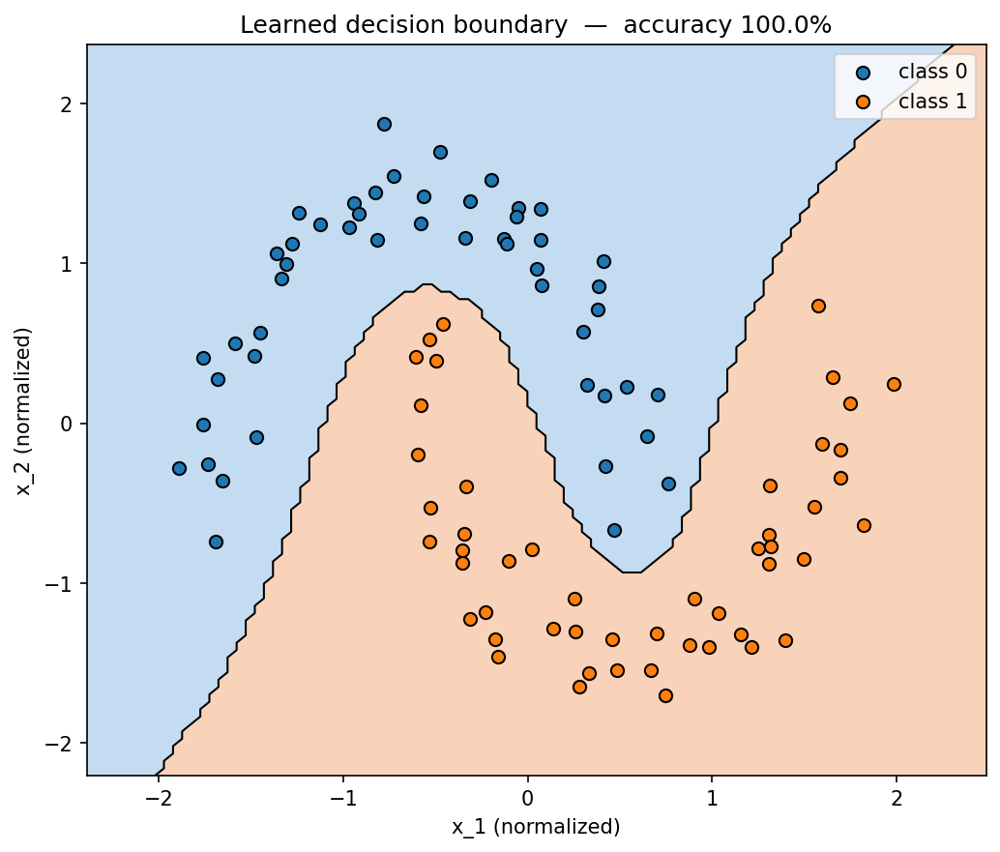

# micrograd


A scalar autograd engine small enough to read in one sitting. It builds a computation graph as you do arithmetic and backpropagates through it. This is the same algorithm as PyTorch's `loss.backward()`, on scalars instead of tensors.

It is the first repo in a series: this one, then [makemore](https://github.com/diego-magana/makemore), then [gpt](https://github.com/diego-magana/gpt).

For the short version, read [`notebooks/spirals_demo.ipynb`](notebooks/spirals_demo.ipynb). It goes from the engine to a trained classifier with all outputs shown.

## How it works

A `Value` wraps one scalar and overloads Python's operators. Writing `a * b + c` builds the graph. Each `Value` stores its data, its gradient, the values it was built from and a closure with its local derivative rule. `backward()` walks the graph in reverse topological order and applies the chain rule at each node.

The engine has eight gradient rules:

- Three operators: `+`, `*`, `**`. Subtraction, division, negation and the reflected variants are composed from these.
- Five functions: `tanh`, `exp`, `log`, `relu`, `sigmoid`.

Two details are easy to get wrong:

- Gradients accumulate with `+=`. A node used in more than one place, such as `x` in `x * x`, has to sum the contributions from every path.
- `backward()` needs topological order. A node can only pass its gradient to its inputs after it has received the full gradient from everything that uses it.

The engine and the `nn` library use only the standard library (`math`, `random`). NumPy and PyTorch appear only in the demo and the tests.

## Verification

Every gradient is checked against PyTorch to 1e-5. This covers the primitives, `relu`, `sigmoid` and a full softmax + negative log-likelihood built from those primitives. The softmax case sends every logit through a shared denominator, so it is a good test of gradient accumulation.

## Demo: three spirals

The notebook trains a classifier on three interleaved spirals, a 2D three-class dataset I generate directly. A linear model cannot separate spirals, so the notebook first shows the linear model failing, then trains an MLP, then checks it on a held-out split.

| Model | Params | Test accuracy |
|---|---:|---:|
| Linear softmax, `MLP(2, [3])` | 9 | 0.27 |
| `MLP(2, [16, 16, 3])`, tanh + softmax | 371 | 0.87 (train 0.99) |

The linear model's test NLL is 1.14. Uniform guessing gives ln 3 = 1.10. The model is not undertrained: its loss does not change between step 80 and step 3,000, and the gradient norm reaches 1e-16.

[](notebooks/spirals_demo.ipynb)

## Run it

```bash
pip install -e .                   # the package has no dependencies
pip install -r requirements.txt    # for the tests and the demo
pytest
jupyter notebook notebooks/spirals_demo.ipynb
```

## Notes

- `sigmoid` could be written as `1/(1+exp(-x))` using the existing rules. It has its own rule, branching on the sign of the input, so large negative inputs do not overflow `exp`.
- `tanh` uses `math.tanh`. The algebraic form `(e^{2x}-1)/(e^{2x}+1)` overflows for large inputs.
- `relu` is the one rule that cannot be composed from the others, because it needs a comparison.
- One `Value` per number and a Python loop per forward pass is slow. That is fine for about a hundred 2D points and is the price of being able to read every step.

## Attribution

The engine and MLP design follow Andrej Karpathy's [micrograd](https://github.com/karpathy/micrograd). I added `relu` and `sigmoid` with the stability handling, gradient verification against PyTorch, the three-spiral dataset and multi-class demo, and the tests and CI.
